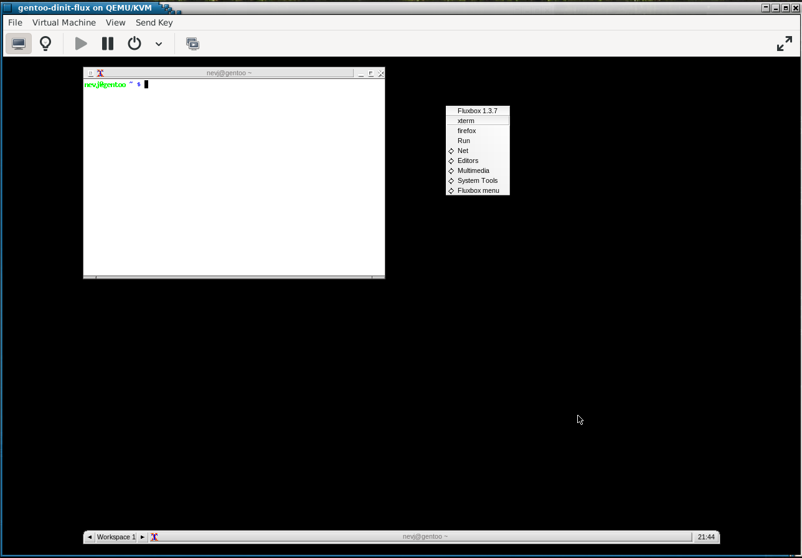
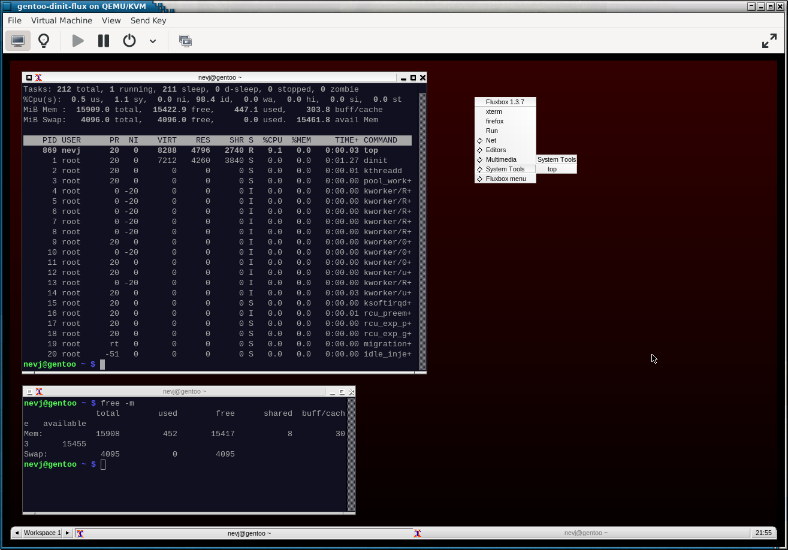

#### Building a minimal xserver and window manager system ####

This is the saga of a poorly planned project that in the end achieved something, but only after some weeks of testing bad choices. 

##### Introduction #####
I started this project with the idea the X11 was both large and dated. I found an interesting article by @sourav

https://itsfoss.com/projects-keeping-x11-alive/

You can read Sourav's article to see all the interesting X11 alternative projects.  I chose to look at 2
 - frame  -- an X server for x86_64 written in assembler using AI
 - Yserver -- an X server written in rust with substantial AI assistence.

I managed to get both installed in a minimal Gentoo system which had only a console and dinit init system.  Neither would support the X requirements of simple window manager like Fluxbox.

I next tried something that Sourav's article does not mention ... an X virtual framebuffer system called `Xvfb` What Xvfb does is allocate an area of ram called a framebuffer and  write all screen image operations there. 
I almost  got there.  The problem with Xvfb is there is no way to display the contents of the framebuffer inside a VM.   It used to work,  when Linux used (UMS) ie X managed the user space framebuffer memory, but in modern Linux teh video memory is in kernelspace ( KMS) and is managed by DRM. 

One can , it seems , access an Xvfb framebuffer, from outside a headless VM,  using VNC/X11 forwarding. That is not what I wanted. 

There is one other X server replacement mentioned by Sourav, that would be ideal. It is called Phoenix, and is an entire X11 system rewritten in the Zig language.  Zig is the language that the kernel people should have chosen instead of Rust. It is and enhanced version of C. Rust is more like an enhanced version of C++.  Unfortunately Phoenix is not complete enough to be tested publicly today.  I dont know what its AI-usage status is?

I did not consider Wayland. I want to run an X window manager.

That left me with one option ... a minimal version of original X11. 


##### Installing a minimal X11 in Gentoo ####
To just run fluxbox, I dont need all the X11 libraries and tools, or Qt. I do need GTK+ and Mesa 
Starting with a minimal Gentoo + dinit + vi. Adding dinit and vi to Gentoo is trivial. It looks like this

<p align="center">

</p>


A console with a login prompt.
 I then do the following


 1. Configure global flags so compiler knows what to include or exclude
```
# Add libseat globally, and remove any accidental elogind/systemd dependencies
USE="X xorg libseat -elogind -systemd"

# Configure the virtualization and software drivers needed
VIDEO_CARDS="virgl lavapipe"
```

 2. Setup some important package specific flags in /etc/portage/package.use

For the Seat Daemon (instructs Portage to actually build the background server binary called `seatd`):
```
echo "sys-auth/seatd server" > /etc/portage/package.use/seatd
```
I need seatd, because I am not running elogind or turnstile or consolekit. Modern Xorg expects a daemon to help it access /dev/tty0 as a normal user ( old Xorg used a setuid bit and a config file setting).

For Xorg-Server (ensures it links against the seat architecture):
```
echo "x11-base/xorg-server libseat" > /etc/portage/package.use/xorg-server
```

For Mesa (enables standard Vulkan/OpenGL software rasterizers and links them to libseat):
```
echo "media-libs/mesa vulkan video_cards_lavapipe libseat" > /etc/portage/package.use/mesa
```
I need `mesa`  because it supplies the  virtual graphics driver 'virgl'.  With Gentoo I can compile it with only the drivers needed for a VM.
 
 For xterm ( compile with Truetype fonts)
```
echo "x11-terms/xterm truetype" > /etc/portage/package.use/xterm
```

 3. Install software
We need a display engine, a window manager, and some minimal utilities
```
emerge --ask x11-base/xorg-server x11-apps/xinit x11-wm/fluxbox x11-terms/xterm media-gfx/feh sys-auth/seatd
emerge --ask x11-apps/xset
```
Compiling the xorg-server drags in mesa. 
Feh is to help fluxbox with background config.
xinit is needed to start Fluxbox
xset is needed to setup fonts

 4. Configure /etc/groups
My user account needs extra permissions 
```
gpasswd -a nevj seat
gpasswd -a nevj video
gpasswd -a nevj input
gpasswd -a nevj tty
```

 5. Fix /etc/hosts file for xauth

```
127.0.0.1       localhost your-hostname-here
::1             localhost your-hostname-here
```
the localhost entry needs to explicitely mention the hostname

 6. Start seatd
Seatd is needeed in place of elogind
```
sudo dinitctl start seatd
sudo dinitctl enable seatd
```

 7. Make a starup alias
Add to ~/.bashrc
```
# Instructs Xorg components to route through seatd
export LIBSEAT_BACKEND="seatd"

# Start command
alias startflux='startx $(which startfluxbox) -- vt1 -keeptty'
```
The arguments to startx force Xorg to use the exact workspace that seatd has already authorised.

Run source ~/.bashrc to refresh the terminal session

We are now ready to launch fluxbox from the console
May need to reboot first.
```
startflux
```
It looks like this

<p align="center">

</p>

We get a raw `fluxbox` screen with a black background, a lower panel with a workspace switcher, and dropdown menus from which I can start an Xterm. Fluxbox can look better than that .... it needs some configuring.

##### Configuring fluxbox #####

 1. Mouse focus. 
This is easily set in Fluxbox Menu -> Configure -> Focus Model. 
I prefer not to have to click to focus

 2. Xterm
The default Xterm is a bit small and needs a scrollbar and some color.
There is no .Xresources file present in my home directory by default (?), so I add a generic .Xresources from another distro, then append the following lines
```
!right hand side scrollbar
xterm*ScrollBar: true
xterm*rightScrollBar: true

!stop output to terminal from jumping down to bottom of scroll again
xterm*scrollTtyOutput: false
xterm*metaSendsEscape: true

! xterm geometry
xterm*geometry: 82x28
! Force xterm to look for and render Truetype/Vector fonts ( rather than legacy bitmap fonts)
xterm*renderFont: true
! set TrueType font and size
xterm*faceName: Monospace
xterm*faceSize: 10
```
That gives me an Xterm with a scrollbar and a decent sized font, plus a color set by my generic .Xresources file.

 3. Fluxbox background
There are variious ways of setting the screen background to either a color or an image. I used the following in ~/.fluxbox/startup
```
# Load Xresources configurations
[[ -f ~/.Xresources ]] && xrdb -merge ~/.Xresources &
fbsetroot -gradient vertical -from "#330000" -to "#050000"
exec fluxbox
```
Startup needs to be executable
```
chmod 755 ~/.fluxbox/startup
```


My minimal raw Fluxbox WM now looks like this

<p align="center">
 
</p>

In Virt-manager  it may need the following settings
 - Video Virtio ( not QXL) 
 - Display Spice set Spice Server, None, OpenGL

That is not quite  sufficient for my purpose. I need copy/paste to work.

##### Copy/paste between VM and host #####
To copy/paste between a Virt-Manager VM and its host , one needs to install s`spice-vdagent` in the guest. That is done in Gentoo as follows
```
emerge --ask app-emulation/spice-vdagent
```
Then make sure the item labelledl 'Channel (spice)' in Virt-manager is set to 'virtio'
```
channel type="spicevmc">
  <target type="virtio" name="com.redhat.spice.0" state="disconnected"/>
  <alias name="channel1"/>
  <address type="virtio-serial" controller="0" bus="0" port="2"/>
</channel>
```

There are 2 daemons .... `spice-vdagentd` has to be started by dinit at boot so it needs a dinit service file in /etc/dinit.d/spice-vdagentd
```
type = process
command = /usr/bin/spice-vdagentd -x
restart = true
depends-on = login.target
logfile = /var/log/spice-vdagentd.log
```
and you ensure it starts at boot with 
```
dinitctl enable spice-vdagentd
dinitctl start spice-vdagentd
```

Then there is a daemon called 'spice-vdagent' which needs to start when Fluxbox is started. In DE's this happens automatically, but with Fluxbox it needs to be put in the Fluxbox startup file.  Here is my file ~/.fluxbox/startup
```
# Load Xresources configurations
[[ -f ~/.Xresources ]] && xrdb -merge ~/.Xresources &
# set backgroung  color gradient
fbsetroot -gradient vertical -from "#330000" -to "#050000"
# start spice user session agent
spice-vdagent &
# start fluxbox
exec fluxbox
```
You can see it sets up .Xresources, the background color, starts spice-vdagent, then starts fluxbox.

There should then be 2 daemons running
```
nevj@gentoo ~ $ ps ax | grep spice
    734 ?        Ssl    0:00 /usr/bin/spice-vdagentd -x
    840 ?        Ssl    0:00 spice-vdagent
```
and copy/paste will work to and from the host.


##### Why did I do this? #####
I have always wanted a workspace that was like my old Freebsd 2.x .... an Xserver and a window system, but no DE or other messy parts of X11.  All I wanted her was a couple of floating Xterm windows. I can work happily on such a primitive system.

So I set out to build it , in a VM with Gentoo and the dinit init system as my base.  I found I could use only the xserver part of X11, plus mesa to get some drivers, plus Fluxbox window manager to get some Xterm windows. 

 I end up with a VM worksystem that 
 - boots in 3 seconds
 - runs with 376 MB of ram ( as a console)
 - runs with 441MB of ram ( with fluxbox)
 - has floating Xterm windows 
 - has 4 switchable workspaces
 - uses 28Gb for the qcow2 VM file

For a pure programming job, it is nice to be able to isolate in my mini-VM, away from all the bloat of a DE ... and it is a nostalgia trip. 

As an example of project planning, this is a great demo of how not to do it. Test crazy ideas first, dont dive in like I did, and learn more about how thngs work before you start.

After finishing my mini-wm-vm project, and making the writeup, the first thing I did was do it all again... following my own writeup. That does 2 things
 - checks the writeup
 - leaves behind all the false tracks I made while trying to implement bad decicions.

I did use some AI ... in debugging gentoo USE flags, and in finding out how to configure Fluxbox... but the writing is entirel my human scrawl. 

If anyone wanted to have such a build, but were reluctant to use Gentoo, One could get almost the same thing by installing antiX26 and choosin the Fluxbox WM.  Fluxbox would still need to be configured, but the other steps could be avoided.
